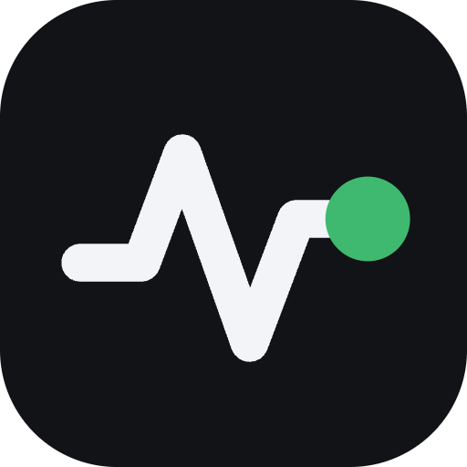
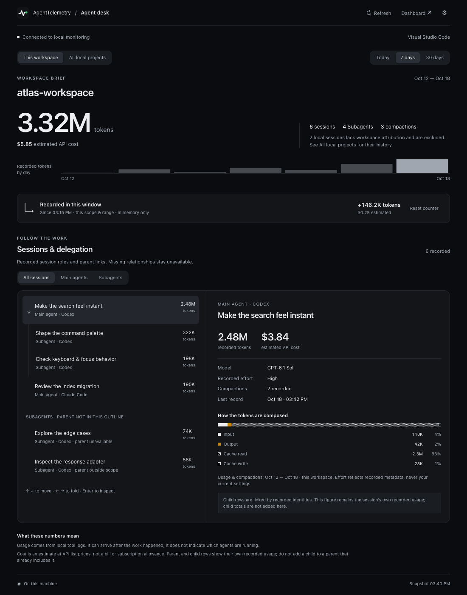

<p></p>

# AgentTelemetry for desktop editors

An **Agent desk** for the coding tools you use: recorded tokens, estimated API cost, sessions and delegation, beside your code. It reads the local logs your tools already write through AgentTelemetry's shared Python backend, whose log-ingestion engine is AgentTelemetry Pulsar. No provider API key or additional Python packages are required.

<p></p>

Shown with demonstration data. [See the light theme](screenshots/agent-desk-light.png).

## Get the desktop app

AgentTelemetry also ships as a **macOS menu bar app** and a **Windows tray app**. Each bundles its own Python, so there is no terminal setup and no separate Python install: open the app, make sure monitoring is on, and this extension attaches to its local service automatically. If your computer has no Python 3.9 or newer, the app is the simplest way to start.

**[Download the latest release](https://github.com/uttamdeb/agent-telemetry/releases/latest)** for macOS 13+ (Apple Silicon or Intel DMG) or Windows 10/11 (x64 installer), or see the [product and install page](https://agenttelemetry-app.vercel.app/). These builds are unsigned/unnotarized: macOS may require **System Settings → Privacy & Security → Open Anyway**, and Windows SmartScreen may require **More info → Run anyway**. You can also run **AgentTelemetry: Get the desktop app** from the Command Palette.

## Follow the work

- **Start with your workspace.** The brief matches recorded absolute working directories to your open local folders. Two projects with the same folder name do not get merged by name. Switch to **All local projects** to include history without a recorded workspace path.
- **See delegation with evidence.** A keyboard-operable outline links sessions only when the source records their parent identities. Filter **All sessions**, **Main agents** or **Subagents**, then inspect a session's model, recorded effort, context compactions and input/output/cache composition. Missing parents stay visibly unavailable or outside the selected scope.
- **Measure newly recorded usage.** The **Recorded in this window** counter subtracts an in-memory baseline from the selected scope's recorded totals. It shows its start time and can be reset. It measures new log observations, including delayed records; it does not identify running agents or measure activity inside this editor.
- **See what's active now.** The sidebar's **Active now** section lists the sessions in the selected scope with activity recorded in the last 15 minutes, newest first, with their tool, how long ago and tokens so far; click one to open it in the Agent desk. It is recent recorded activity, not proof that an agent is still running.
- **Keep the wider picture close.** The native activity sidebar and status bar show the selected scope's usage. Open the Agent desk for detail or the full local dashboard for the rest of AgentTelemetry.

The Agent desk uses AgentTelemetry's app icon and light/dark design, with editor high-contrast support, visible keyboard focus and reduced-motion support. Its bundled interface makes no network requests; the extension host communicates with the local service.

## Install

In desktop Visual Studio Code, open **Extensions**, search for **AgentTelemetry** by **AgentTelemetry Team** (extension ID **`agenttelemetry-team.agenttelemetry`**). Click **Install**, then open its waveform icon in the activity bar or run **AgentTelemetry: Open Agent desk** from the Command Palette.

You can also install from the terminal:

```bash
code --install-extension agenttelemetry-team.agenttelemetry
```

### Install a VSIX in another desktop editor

Use the provided `agenttelemetry-2.1.0.vsix` in a **desktop** VS Code, Cursor, Antigravity or compatible VS Code fork supporting the VS Code 1.85+ API and a local extension host.

1. Open the editor's Extensions view.
2. Choose **Install from VSIX…** from the Extensions menu or Command Palette.
3. Select the VSIX and reload the editor if requested.
4. Open the AgentTelemetry waveform icon in the activity bar, or run **AgentTelemetry: Open Agent desk**.

The same universal VSIX contains the cross-platform extension and stdlib-only backend. It does not bundle a new Python interpreter. Browser-only editors such as `vscode.dev` cannot run this desktop extension.

### Install from Cursor or Antigravity

Search for **AgentTelemetry** in the editor's extension marketplace. Cursor and compatible
editors can install the same extension from [Open VSX](https://open-vsx.org/extension/agenttelemetry-team/agenttelemetry)
when the listing is available there. If the editor does not offer that listing, use the
universal VSIX instructions above. Google Antigravity's extension for standard VS Code is
a separate product from the standalone Antigravity IDE.

## First connection

If an AgentTelemetry service is already listening on `127.0.0.1:7878`, the extension identifies it and attaches automatically. Attaching requires no new Python process and uses that service's existing ledger. It never stops a service it finds.

If no service is running, choose **Start local monitoring** in the Agent desk or **AgentTelemetry: Start monitoring**. The first start explains that the shared local service **keeps running after the editor closes**, so other editor windows and native clients can use it. Starting is explicit; installing or opening the extension does not start Python automatically.

Starting needs **Python 3.9 or newer** on this computer. Discovery first checks supported installed AgentTelemetry runtime locations on macOS and Windows, then trusted local `PATH` entries. You can choose an existing interpreter with **AgentTelemetry: Set up Python** or set `agentTelemetry.pythonPath` to its absolute executable path. The interpreter must be outside the workspace. The extension does not install Python or packages automatically.

**No Python?** Install the [desktop app](https://github.com/uttamdeb/agent-telemetry/releases/latest) instead. It bundles its own Python, which the discovery above checks first, so **Start local monitoring** can use it, and a running app is attached automatically. The Agent desk's offline notice and the Python setup prompts also offer **Get the desktop app**.

A service started by the extension uses port **7878** and AgentTelemetry's native default ledger directory:

| System | Ledger directory |
| --- | --- |
| macOS | `~/Library/Application Support/AgentTelemetry` |
| Windows | `%LOCALAPPDATA%\AgentTelemetry` |
| Linux | `$XDG_STATE_HOME/AgentTelemetry`, or `~/.local/state/AgentTelemetry` |

Existing checkout-local caches are not imported automatically. To continue using a dashboard with its own ledger location, start that dashboard first and let the extension attach to it. Starting monitoring never rebuilds or deletes a ledger.

The first scan can take a minute for a large log history. If the local port belongs to another application, the extension reports it and does not replace that application or start a competing service. An older AgentTelemetry backend that lacks the editor endpoint gets an **Upgrade your local backend** message; use the dashboard's available update flow or update the installation that owns that service, then retry.

## Scope, ranges and controls

The Agent desk offers **This workspace** / **All local projects** and **Today** / **7 days** / **30 days**. These choices also drive the native sidebar and status bar. Session-type filters affect the outline, not the brief's aggregate totals.

Select a session with the mouse or use **↑ / ↓** to move, **← / →** to collapse or expand, and **Enter** to inspect. A linked parent's title in the inspector navigates back to that session. If the session list is capped, the desk says how many are shown; the brief still includes all matching usage.

The recorded-usage counter resets when the extension host reloads, the workspace/scope/range or reporting date changes, the backend identity changes, or recorded counters decrease. **Reset counter** starts a fresh baseline without changing logs or ledger data. Closing just the Agent desk panel does not reset the extension host's counter.

| Command Palette action | Purpose |
| --- | --- |
| `AgentTelemetry: Open Agent desk` | Open the workspace brief and session inspector. |
| `AgentTelemetry: Refresh` | Ask the local backend to refresh recorded usage. |
| `AgentTelemetry: Start monitoring` | Explicitly attach to or start the shared local service. |
| `AgentTelemetry: Open local dashboard` | Open the identified service in your browser. |
| `AgentTelemetry: Reset usage baseline` | Reset the in-memory counter for this scope. |
| `AgentTelemetry: Set up Python` | Choose an existing interpreter, open Python's download page or get the desktop app. |
| `AgentTelemetry: Get the desktop app` | Open the latest release page with the macOS and Windows installers. |
| `AgentTelemetry: Open settings` | Open the extension's settings. |

## Remote and restricted windows

The extension runs in the **local UI extension host**, including in desktop Remote SSH, container and similar remote windows. It reads this computer's AgentTelemetry service. Remote workspace paths are not treated as local folders: **This workspace** is disabled and the desk explicitly shows **All local projects** on this machine. Remote logs and paired devices are excluded from the editor projection.

Restricted Mode permits read-only attachment to an existing local service. Starting Python requires a trusted workspace. Settings are read from application defaults and user settings, never workspace-supplied settings.

## Settings

| Setting | Default | Meaning |
| --- | --- | --- |
| `agentTelemetry.port` | `7878` | Attach to an existing service on this loopback port. Starting a service requires the default port. |
| `agentTelemetry.pythonPath` | Empty | Discover an interpreter, or use an absolute trusted Python executable path outside the workspace. |
| `agentTelemetry.showStatusBar` | `true` | Show the selected scope's tokens and estimated cost in the status bar. |

## Optional MCP analytics

Version **2.1.0** bundles the current AgentTelemetry backend, including its optional
read-only MCP bridge. The application and MCP server are also **2.1.0**. Updating this extension
does not replace a dashboard service that is already running: update and restart the
installation owning that service to use its newest features.

To connect a compatible AI client, open **AgentTelemetry: Open local dashboard**,
then **Settings → Local MCP access**. Review the sharing warning, enable access and
copy the generated configuration into your MCP client. Keep the local dashboard
running; the bridge does not start it automatically. Project/device display names
and usage from paired devices require separate consent and are off by default.
Revoke access in Settings at any time. The extension never changes an AI client's
configuration or enables MCP on installation.

The eight tools cover usage, comparisons, insights, sessions, session timelines,
data health, available dimensions and saved subscription-limit observations.
They cannot rename sessions, run server commands, change settings, refresh account
credentials or make model calls. Results exclude prompts, transcript text, session
titles, native IDs, paths and account identities. A cloud-backed client may send
the returned telemetry to its provider, so enable access only when intended.
See the [MCP setup and privacy guide](https://github.com/uttamdeb/agent-telemetry/blob/HEAD/docs/mcp.md).

## Read the numbers accurately

Costs are estimates at published API list prices, **not bills or subscription allowances**. Tokens depend on what each coding tool records; unavailable usage, effort, parent links and compaction metadata are not guessed from another session or current settings. Effort and compactions are shown for the selected reporting scope, and compactions add no extra token charge by themselves.

Parent and child rows retain their own recorded usage. A tool can already include sidechain usage in a parent, so adding every child row to that parent can double-count. Main-agent labels distinguish the session list from recorded Subagents; they do not establish a parent link.

Connection failures retain the last successful snapshot and mark it stale while retries continue. The counter also stays marked stale until a successful connection. This is recorded history, not a live agent process monitor.

The extension performs no account lookup, provider model call, credential read or session rename. Analytics stay local: the extension does not upload telemetry. Explicit browser actions can open the local dashboard, Python's download page or the desktop app's release page on GitHub. The full dashboard's separate opt-in features retain their own consent controls.

## More ways to get AgentTelemetry

- **Desktop apps** for [macOS and Windows](https://github.com/uttamdeb/agent-telemetry/releases/latest), with their own Python.
- **[Product and install page](https://agenttelemetry-app.vercel.app/)**.
- **This extension** on the [Visual Studio Marketplace](https://marketplace.visualstudio.com/items?itemName=agenttelemetry-team.agenttelemetry) and on [Open VSX](https://open-vsx.org/extension/agenttelemetry-team/agenttelemetry).
- **Browser dashboard and source**: the [Python package or source checkout](https://github.com/uttamdeb/agent-telemetry#quick-start) on GitHub.

## License

MIT. See [LICENSE](LICENSE).
